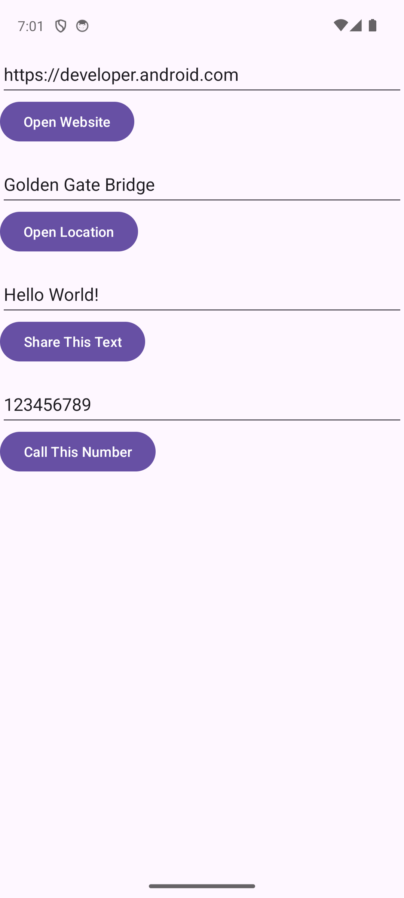
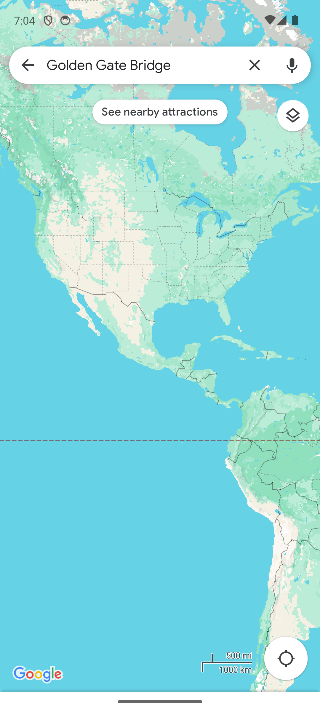
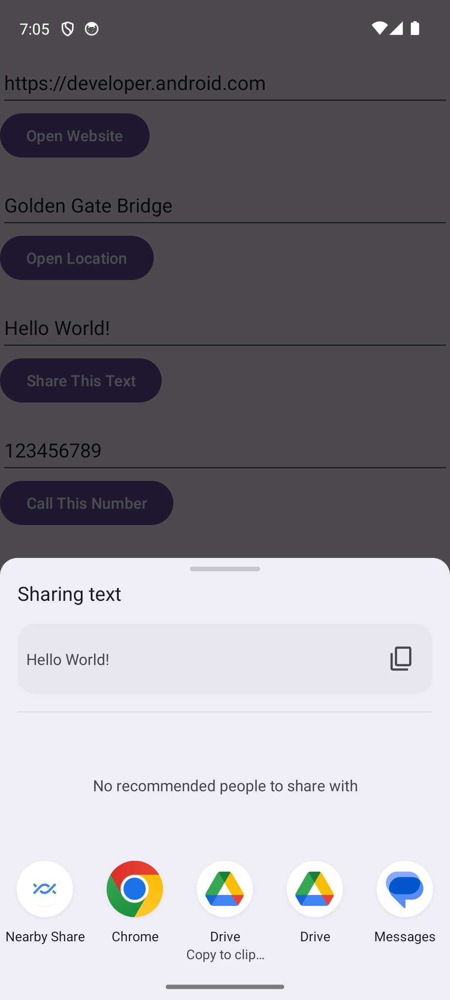
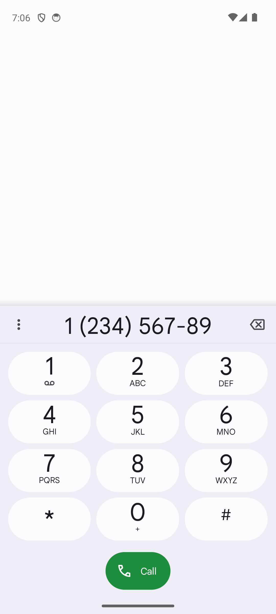

# Implicitni nameni (ImplicitIntents)

Preprosta Android aplikacija za spoznavanje uporabe implicitnih namenov (Implicit Intents), narejena pri predmetu MOAp. Namen naloge je spoznavanje povezovanja z drugimi sistemskimi in zunanjimi aplikacijami (brskalnik, zemljevidi, deljenje besedila ter klicanje) brez neposrednega navajanja točnega razreda ciljne aktivnosti.

## Opis aplikacije

Aplikacija ponuja štiri glavne funkcionalnosti preko navpične postavitve (`LinearLayout`):
- **Odpri spletno stran (Open Website)**: Vnos spletnega naslova (`https://...`) in odpiranje v spletnem brskalniku z uporabo akcije `Intent.ACTION_VIEW`.
- **Prikaži lokacijo (Open Location)**: Vnos lokacije (npr. *Golden Gate Bridge*) in prikaz na zemljevidu z uporabo geografskega URI-ja `geo:0,0?q=...` ter akcije `Intent.ACTION_VIEW`.
- **Deli besedilo (Share This Text)**: Vnos poljubnega besedila in sprožitev sistemskega izbirnika za deljenje z uporabo `ShareCompat.IntentBuilder` ter MIME tipa `text/plain`.
- **Klic telefonske številke (Call This Number)**: Vnos telefonske številke in odpiranje telefonskega klicalnika z uporabo sheme `tel:...` ter akcije `Intent.ACTION_DIAL`.

Pred zagonom namenov se z metodo `resolveActivity()` preveri, ali je na napravi na voljo ustrezna aplikacija za obdelavo namena. Vsa besedila in sporočila so shranjena v `strings.xml`.

## Ikona aplikacije

Privzeta ikona aplikacije je bila zamenjana z ikono za deljenje (Clip Art *Share*) preko orodja Asset Studio v Android Studiu. Datoteke ikone se nahajajo na poti:
- `app/src/main/res/mipmap-anydpi-v26/ic_launcher.xml`
- `app/src/main/res/drawable/ic_launcher_foreground.xml`
- `app/src/main/res/drawable/ic_launcher_background.xml`
- `app/src/main/res/mipmap-*/ic_launcher.webp`

## Posnetki aplikacije

| Začetni zaslon | Spletna stran | Prikaz lokacije | Deljenje besedila | Klicanje |
|---|---|---|---|---|
|  |  |  |  |  |
